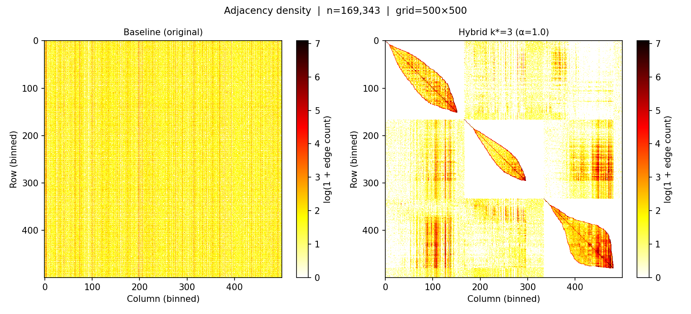
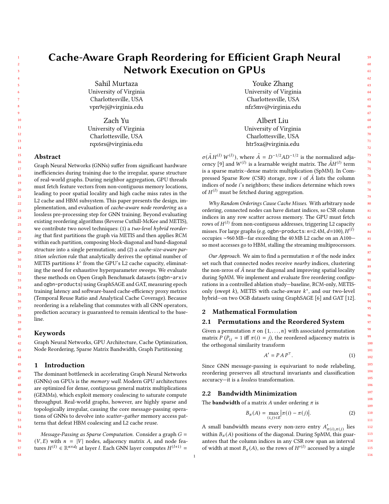
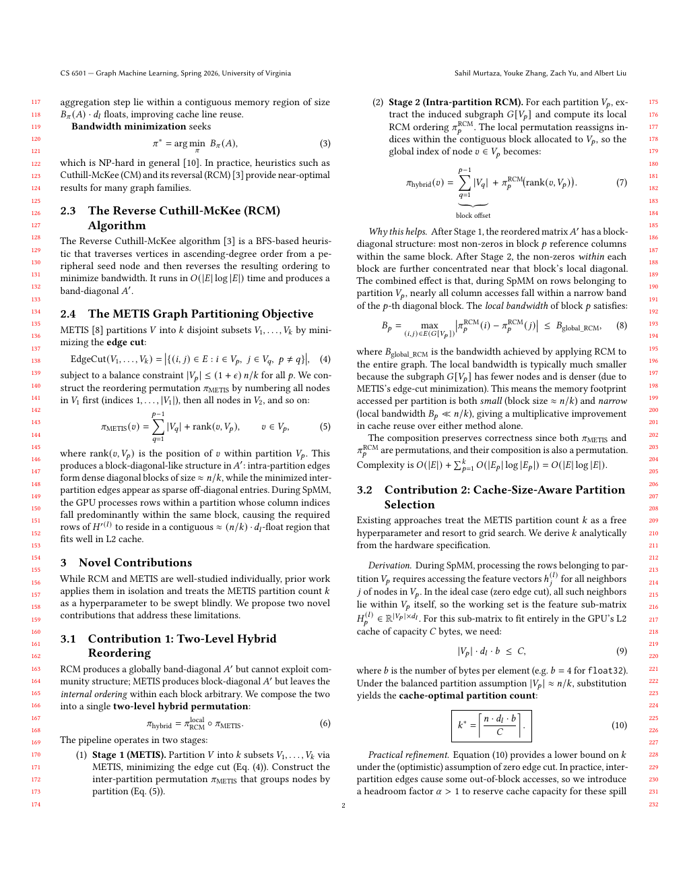
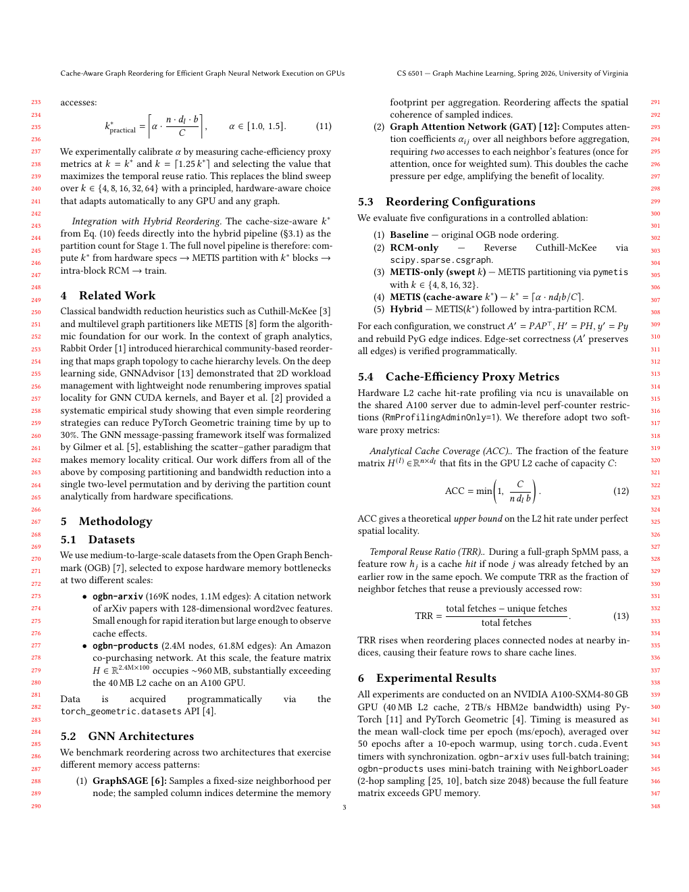
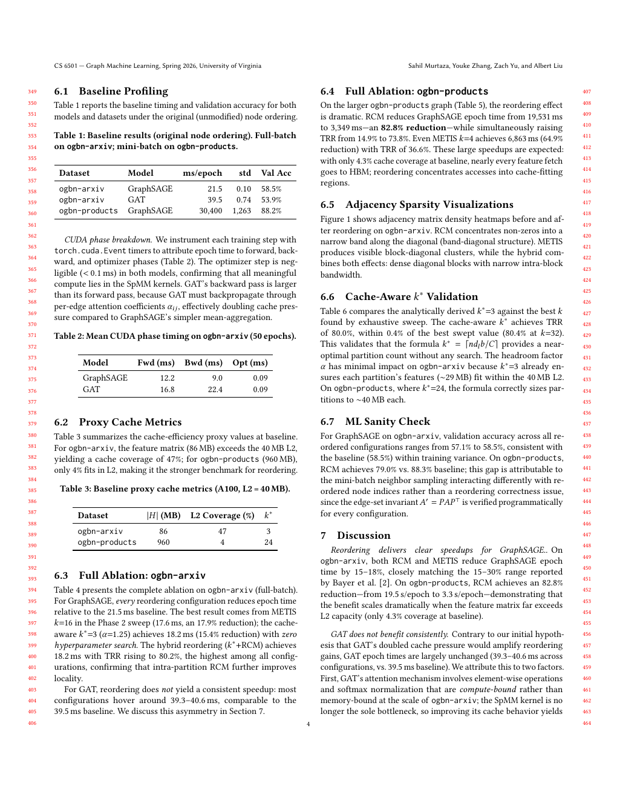
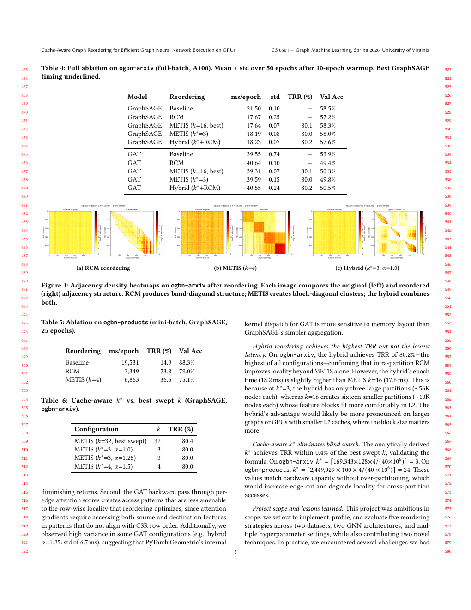
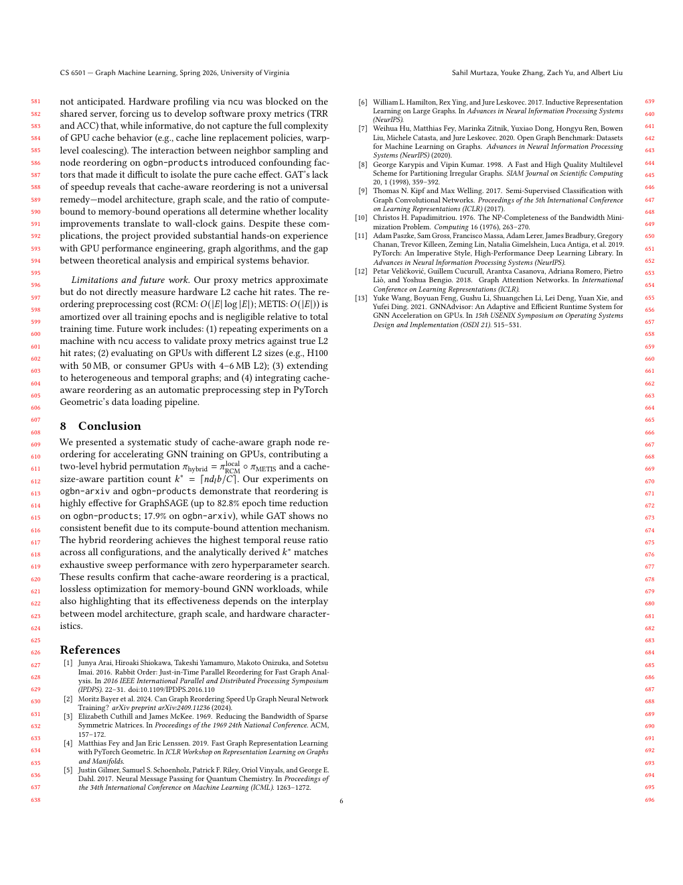

# Cache-Aware Graph Reordering for Efficient GNN Execution on GPUs

Final project for **CS 6501 · Graph Machine Learning · University of Virginia**.
By Sahil Murtaza, Youke Zhang, Zach Yu, and Albert Liu.

Reorder graph nodes before GNN training to improve memory locality. The project
compares Reverse Cuthill–McKee (RCM), METIS partitioning, a cache-size-based
partition count, and a hybrid of METIS followed by RCM within each partition.

[**Read the final paper (PDF)**](graph_ml_final/main.pdf) ·
[**Experiment code and reproduction guide**](gnn_reorder/README.md) ·
[**Saved results**](gnn_reorder/results/)

## What the project does



The same graph before (left) and after (right) hybrid reordering. Grouping
connected nodes into diagonal blocks brings their feature vectors closer in
memory. The graph structure is preserved; the node indices change.

The saved A100 experiments show lower GraphSAGE epoch times on `ogbn-arxiv`
(21.50 ms baseline; 17.64 ms with METIS at `k=16`). GAT shows no consistent
speedup. Cache metrics are software proxies, and separately trained runs have
different validation accuracies; permutation equivariance alone does not
guarantee identical measured training outcomes. See the paper for the full
results and limitations.

## Final paper preview

All six pages of the final PDF are shown below. Click a page to open its image,
or [download the full paper](graph_ml_final/main.pdf).

### Page 1

[](graph_ml_final/previews/page-1.png)

### Page 2

[](graph_ml_final/previews/page-2.png)

### Page 3

[](graph_ml_final/previews/page-3.png)

### Page 4

[](graph_ml_final/previews/page-4.png)

### Page 5

[](graph_ml_final/previews/page-5.png)

### Page 6

[](graph_ml_final/previews/page-6.png)

## Repository contents

| Path | Contents |
| --- | --- |
| [`graph_ml_final/`](graph_ml_final/) | Final PDF, LaTeX source, bibliography, paper figures, and every page preview |
| [`gnn_reorder/`](gnn_reorder/) | Dataset loaders, GNN models, reordering methods, profiling, experiment scripts, and saved results |
| [`.build/latexrun.py`](.build/latexrun.py) | LaTeX build helper |

The current tree contains the final deliverable and its implementation.
Earlier proposal/progress reports and template samples remain in Git history.

## Reproduce the outputs

To rebuild the paper, install a TeX distribution with `acmart` and BibTeX. Install
Poppler (`pdftoppm`) to regenerate the preview images. From the repository root:

```bash
make             # build graph_ml_final/main.pdf
make previews    # rebuild the PDF and render all pages
```

To regenerate comparison plots from the committed CSVs without a GPU:

```bash
python -m pip install matplotlib numpy
MPLBACKEND=Agg python gnn_reorder/compare_results.py
```

For GPU training, dataset setup, and experiment commands, use the
[implementation guide](gnn_reorder/README.md). Dataset downloads and temporary
build/profiling files are excluded from Git; final figures and previews are
included.
